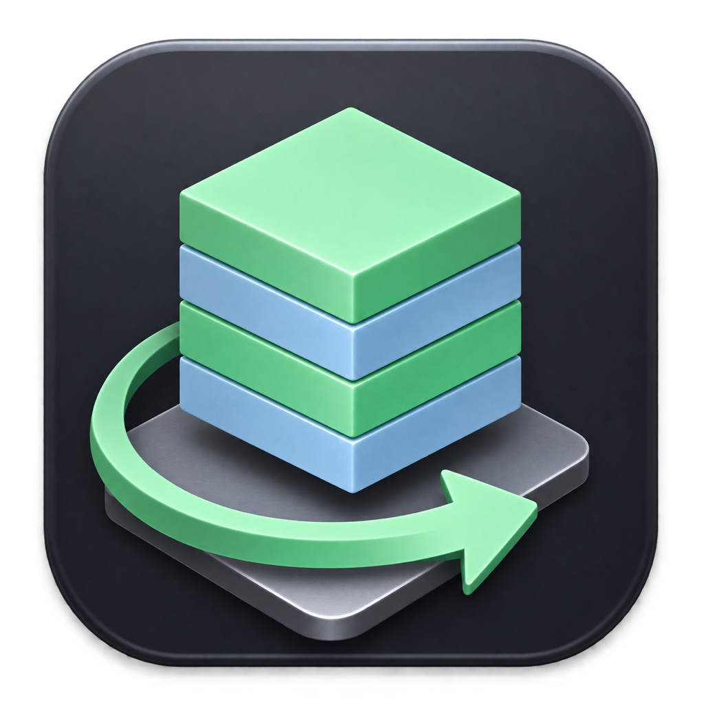
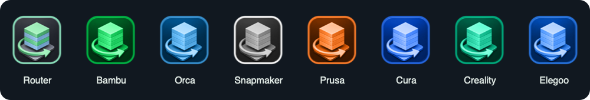
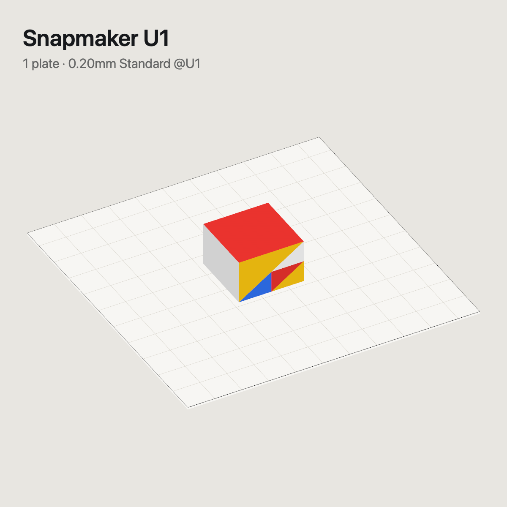
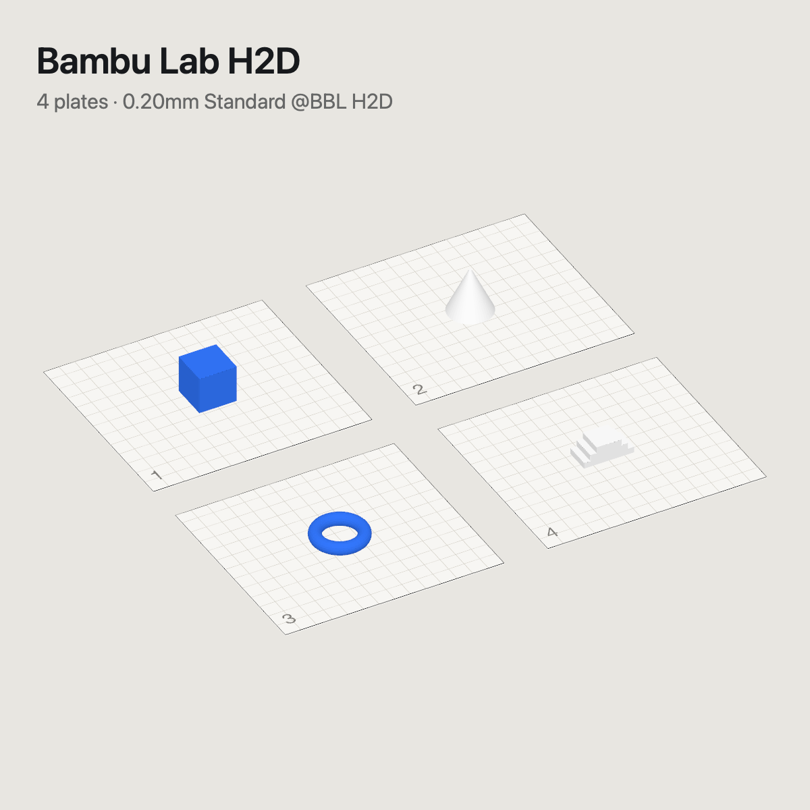
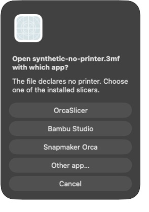

<div align="center">



# 3dSlicerRouter

### The right slicer. Your build plate, at a glance.

**Open your projects in the right slicer, automatically.**<br>
**See your build plate before you even open the file.**

A native macOS app for `.3mf` and `.gcode` routing, Finder icons, thumbnails and Quick Look previews.
Everything runs locally, without an account or a network service.

<table>
<tr><td align="center">
<h2><a href="https://github.com/MoraesGil/3dSlicerRouter/releases/latest/download/3dSlicerRouter.dmg">↓ Download for macOS (.dmg)</a></h2>
<p><strong>Apple silicon + Intel · macOS 14+</strong><br>
Open the DMG and drag to Applications.<br>
No Xcode, Homebrew or Terminal required.</p>
<p><a href="https://github.com/MoraesGil/3dSlicerRouter/releases">All releases</a> · <a href="docs/INSTALL.md">Installation guide</a></p>
</td></tr>
</table>

[](https://github.com/MoraesGil/3dSlicerRouter/actions/workflows/ci.yml)


[](LICENSE)

[Install](docs/INSTALL.md) · [Routing demo](#open-in-the-right-slicer-automatically) · [Preview demo](#see-your-build-plate-before-opening-the-file) · [Português](README.pt-BR.md)

</div>

## Open in the right slicer, automatically

Keep 3dSlicerRouter as the default app for `.3mf` and `.gcode`. Double-click a file: it reads the saved
printer and opens **Bambu Studio**, **OrcaSlicer**, **Snapmaker Orca** or your chosen slicer.
For G-code, it also identifies the slicer that generated the file. A manual choice for the file and an
explicit printer mapping take priority over that generator. With no applicable rule, it asks you to
choose from the slicers installed on your Mac.



## See your build plate before opening the file



Small **Finder** icons use the Router logo with the chosen slicer's colour and marker.
Large previews preserve the part and its colours. Find the right project by its geometry and colours.
Thumbnails show the first build plate. Select a file and press **Space** for **Quick Look**: orbit and zoom a single-plate
project in 3D, or see all plates together in a multi-plate project. You do not need to launch a slicer.

| One plate, painted colours | Multiple plates, one overview |
|---|---|
|  |  |

*Previews generated by 3dSlicerRouter from the synthetic projects in [samples/](samples/).*

- **3MF geometry and colours:** previews use the model, filament colours and painted faces saved in the project.
- **G-code previews:** embedded thumbnails are shown when available; otherwise, the app renders the
  extrusion path in each tool's filament colour. Quick Look opens the toolpath in 3D.
- **Local rendering:** SceneKit and Metal generate the previews on your Mac. No AI model, API key or account is required.

Finder uses a current indexed thumbnail when available, or renders the current first-plate geometry
on demand. If rendering fails or the compressed project exceeds 250 MB, it falls back to the slicer's
saved first-plate image, which can be out of date. [Background indexing](#background-previews-optional) is optional.

## The problem

Bambu Studio, Snapmaker Orca, OrcaSlicer and PrusaSlicer all save `.3mf`, and Finder can only
have one default app for it. With printers from two brands you end up opening a U1 project in
Bambu Studio (or an A1 project in Orca) and getting preset warnings, missing filaments or a bed type
that changed without you noticing.

3dSlicerRouter becomes the default app for `.3mf` and `.gcode`. It reads `printer_model` and hands the
file to the configured slicer. For G-code, it also uses the identified generator, after manual choices
and explicit mappings. With no applicable rule, it asks you to choose an installed slicer.

## Any printer, any slicer

| | Printer in the file | Opens in |
|:-:|---|---|
|  | `Bambu Lab A1`, `A1 mini`, `P1S`, `X1C`, `H2D`, … | **Bambu Studio** |
| | `Snapmaker U1`, `J1`, `Artisan`, … | **OrcaSlicer (official)** |
| | `Prusa`, `Original Prusa`, … | **OrcaSlicer (official)** |
| | Anything else (`Elegoo Centauri Carbon`, …) | **OrcaSlicer (official)** |
| | No printer declared | **Ask among installed slicers** |

The official OrcaSlicer is the default for new non-Bambu projects. Hold Option when opening to
choose among installed slicers or **Other app…**, a native picker for any slicer
in `/Applications`. Tick *Always use for this printer* to override the default for that model.
You can also map printers from the terminal:

```sh
3dSlicerRouter --map "Original Prusa MK4S" /Applications/PrusaSlicer.app
3dSlicerRouter --mappings
```

Need the other slicer for one file? **Hold ⌥ (Option) while opening** and pick. Finder's
*Open With* keeps working too, and the next double-click reads the file again.

## Already open? No second window

Bambu Studio, OrcaSlicer and Snapmaker Orca start a **new instance** when you open a project that is already
open, so you end up editing the same file in two windows. 3dSlicerRouter checks first. When the file
is the open project of a running slicer, it tells you so, says whether it has unsaved changes, and
offers:

- **Switch to the slicer**: activates the running slicer instance.
- **Restart and reload**: closes that slicer instance, which may contain other windows. The slicer
  can ask about unsaved changes before the saved file is reopened.
- **Open another copy**: the old behaviour, if you really want it.

It reads the recovery folders the slicers keep in `$TMPDIR` while a project is open, so it needs no
extra permissions. `3dSlicerRouter --inspect file.3mf` shows the same information.

## Background previews (optional)

> **Ad-hoc build limitation:** background startup is experimental. On the local test Mac, macOS
> intermittently rejected the helper with a launch constraint violation even when registration was
> enabled and the signature verified. Routing and on-demand previews do not depend on this helper.
> If it cannot start, use `--render` or the foreground `--index` command. Do not disable system security.


Big projects take seconds to render. Turn on the indexer and they are ready before you open Finder:

```sh
3dSlicerRouter --background on
```

- It finds every `.3mf` and `.gcode` on the Mac through Spotlight (no disk crawling) and keeps a catalog.
- It wakes every 30 minutes at background priority and **only works on AC power, outside Low Power
  Mode, while the Mac is cool and you have been away for 3 minutes**. It stops as soon as you are back.
- Rendering runs in a separate executable, with a 20-minute run limit and conditions checked every
  5 seconds even during a complex preview, so it cannot occupy the Finder handler.
- Previews go to `~/Library/Application Support/3dSlicerRouter/previews`. Saves invalidate the generated
  image, including same-size saves within one second. The next eligible pass renders current first-plate
  geometry even if the embedded image is old, then notifies Finder. Failed or missing previews are retried.
- macOS shows *Background item added*. You can switch it off in **System Settings › General › Login
  Items** or with `3dSlicerRouter --background off`. The first time it reads files in Desktop,
  Documents, Downloads or an external drive, macOS may ask you to allow it.

`3dSlicerRouter --index-status` shows what it is doing; the log is `~/Library/Logs/3dSlicerRouter/indexer.log`.

## How it decides

The table below describes 3MF routing. G-code uses: confirmed per-file choice → explicit printer mapping → declared generator → printer default or chooser. A file copied from another Mac cannot authorize a new application path.

| Situation | Result |
|---|---|
| First 3MF open | Explicit printer mapping; otherwise Bambu Studio for Bambu Lab, official OrcaSlicer for other printers |
| Same file, same printer | Where it opened last time, manual choices included |
| Printer changed within the brand (A1 → A1 mini) | Same slicer, no question |
| Printer changed to Bambu Lab (U1 → A1) | Bambu Studio, no question |
| Printer changed to another brand (A1 → U1) | Asks, with the mapped slicer first |
| G-code with an identified generator | Manual file choice and explicit printer mapping take priority; otherwise uses the generator |
| No printer and no recognized generator in the file | Remembered manual choice; otherwise asks among installed slicers |
| Assigned slicer was uninstalled | Asks among the remaining installed slicers |
| ⌥ held while opening | Always asks |
| File already open in a slicer | Switch to it, restart and reload, or open another copy |

The decision is stored in a local SQLite index and on the file as an extended attribute
(`com.moraesdev.slicer-router`). Slicers replace the file when they save, which drops the attribute;
the router then finds the decision by path and stamps it again. **The file's contents are never
modified by the router.**

Each choice stores the app's bundle ID, path and name. Official OrcaSlicer
(`com.orcaslicer.OrcaSlicer`, `/Applications/OrcaSlicer.app`) and Snapmaker Orca
(`com.snapmaker.snapmaker-orca`, `/Applications/Snapmaker Orca.app`) are separate choices.
Existing file choices and explicit printer mappings keep priority over the new default.
The recorded installation path is preferred when it still has the matching bundle ID.
Opening a file directly in another slicer does not update the router's choice.

> Why not the `Application` field? Snapmaker Orca also writes `BambuStudio-…` there. The printer comes
> from `Metadata/project_settings.config` → `printer_model`.

## Install

Requires macOS 14 or newer and at least one slicer.

1. **[Download 3dSlicerRouter.dmg](https://github.com/MoraesGil/3dSlicerRouter/releases/latest/download/3dSlicerRouter.dmg)**. One app supports Apple silicon and Intel.
2. Open the DMG and drag **3dSlicerRouter** to **Applications**. Eject the disk image.
3. Open the app from **Applications** and choose **Use for .3mf and .gcode**.

You do not need Xcode, Homebrew or Terminal. The release includes an alternative ZIP and SHA-256 checksums.

**First-launch approval:** the app is ad-hoc signed, without Developer ID signing or notarization.
macOS can block it. If you trust the download, follow Apple's per-app [Open Anyway instructions](https://support.apple.com/102445).
Managed Macs may prevent this approval. Do not disable Gatekeeper or remove quarantine.

<details>
<summary>Build from source (developers)</summary>

```sh
brew install xcodegen
git clone https://github.com/MoraesGil/3dSlicerRouter.git && cd 3dSlicerRouter
./scripts/build.sh --install
alias 3dSlicerRouter=/Applications/3dSlicerRouter.app/Contents/MacOS/3dSlicerRouter   # add to ~/.zshrc
3dSlicerRouter --set-default
```

Local builds use an ad-hoc signature. Developer ID signing and notarization are not provided by this build script.
Dependencies, update and **uninstall**: [docs/INSTALL.md](docs/INSTALL.md).

If Xcode's build service stalls, `./scripts/build.sh --native --test` builds the same universal app and
runs the full test suite using `swiftc` and `xctest`. It still requires Xcode's SDK and command-line tools.

</details>

## Try it

Seven small synthetic 3MF projects in [`samples/`](samples/) demonstrate printer routing and previews:

```sh
open samples/bambu-a1-keychain-tray.3mf        # Bambu Studio
open samples/snapmaker-u1-four-colors.3mf      # OrcaSlicer
open samples/no-printer-declared.3mf          # choose an installed slicer
3dSlicerRouter --inspect samples/*.3mf         # see every decision, opens nothing
```

## Command line

`3dSlicerRouter` is the alias from [Install](#install), pointing at
`/Applications/3dSlicerRouter.app/Contents/MacOS/3dSlicerRouter`.

| Command | What it does |
|---|---|
| `--inspect file.3mf\|file.gcode…` | Printer, thumbnail, remembered choice and decision; does not open a slicer or change file contents |
| `--map "<printer>" /Applications/App.app` | Send that printer to any slicer |
| `--mappings` | List brand defaults and your mappings |
| `--list-slicers` | List installed slicers and their paths |
| `--render file.3mf\|file.gcode out.png [px]` | First plate of a 3MF, or G-code toolpath, as PNG |
| `--background on\|off\|status` | Background preview indexer |
| `--index [--limit N]` | Index and render now, ignoring the idle rule |
| `--index-status` | Indexer state, catalog totals, log path |
| `--catalog [text]` | Every 3MF and G-code found, with printer and preview state |
| `--forget file.3mf\|file.gcode…` | Erase the router's memory for these files |
| `--set-default` | Make the router the default app for `.3mf` and `.gcode` |

## Files with no printer

Files with neither printer metadata nor a recognized G-code generator ask which slicer to use.
The picker checks `/Applications`,
`~/Applications`, their subfolders and macOS registrations for the three main slicers. Only apps
with an existing executable are listed, including PrusaSlicer and other recognized slicers when
installed. Removed apps and broken symlinks are excluded.

Remembered manual choices still apply to their files. Old automatic OrcaSlicer fallbacks for
files without a printer ask again. All routing runs locally.
3dSlicerRouter remains the default application for `.3mf` and `.gcode` files.

<p align="center">

</p>

*Native picker with a synthetic sample. The list reflects the slicers installed on the test Mac.*

## Local rendering and privacy

Thumbnails are rendered from the file's geometry and filament colours with SceneKit and Metal.
Camera and lighting are fixed by code. No AI model is involved. In repeated local checks, the same
synthetic input produced identical PNG hashes; identical pixels across different macOS/GPU versions
are not guaranteed.

The app keeps routing choices, a catalog and preview images in the user's Application Support
folder. The optional indexer only reads files visible to Spotlight and permitted by macOS.
There is no network client or credential configuration in the application.

## FAQ

**Does it touch my files?** It stores routing and Finder icon metadata on the file. The 3MF or G-code
contents stay byte-for-byte the same.

**How does it choose a slicer for G-code?** The Router identifies the generator in the file comments.
A saved manual choice for the file or an explicit printer mapping takes priority.
Hold **⌥ (Option)** when opening to choose another slicer.

**Do all file icons change immediately after installation?** No. Small icons use the Router logo with
the slicer's colour and marker. They update when a file is opened or indexed, and when Finder requests
a thumbnail. Files never opened or indexed can keep their previous icon. Large part previews and
Quick Look remain available. If the file is not writable or its filesystem does not support extended
attributes, opening still works; Finder uses the extension icon or thumbnail fallback.

**Does the preview update after I edit the project?** A save invalidates the generated preview. Finder's
next request renders current first-plate geometry if no indexed image is ready; the optional indexer
prepares it during its next idle pass. Only the error/large-project fallback can retain an old slicer
screenshot. Closing without saving changes nothing.

**Does it need special permissions?** Opening a file and generating its preview do not require
Accessibility, Screen Recording or Full Disk Access. The optional background indexer may need your
approval for background activity and access to protected folders.

**Does it phone home?** No. Routing and previews run entirely on your Mac. No network service,
AI model, API key or account is required.

**Does it run in the background?** Only if you turn on the indexer, and then only while the Mac is idle
and plugged in.

## Roadmap

- [x] Official OrcaSlicer default, separate from Snapmaker Orca
- [ ] Built-in presets for PrusaSlicer, Elegoo Slicer and Creality Print (today: *Other app…* or `--map`)
- [ ] Settings window for printer → slicer mappings
- [ ] Extrusion-width ribbons in the G-code preview
- [ ] Notarized release

Ideas, printers that route wrong and PRs are welcome: [CONTRIBUTING.md](CONTRIBUTING.md).

## Disclaimer

Not affiliated with, endorsed or sponsored by Bambu Lab or Snapmaker. Bambu Studio, Snapmaker Orca
and their icons are trademarks of their owners, shown only to describe compatibility.

## License

[MIT](LICENSE) © Gilberto Moraes ([@MoraesGil](https://github.com/MoraesGil))
