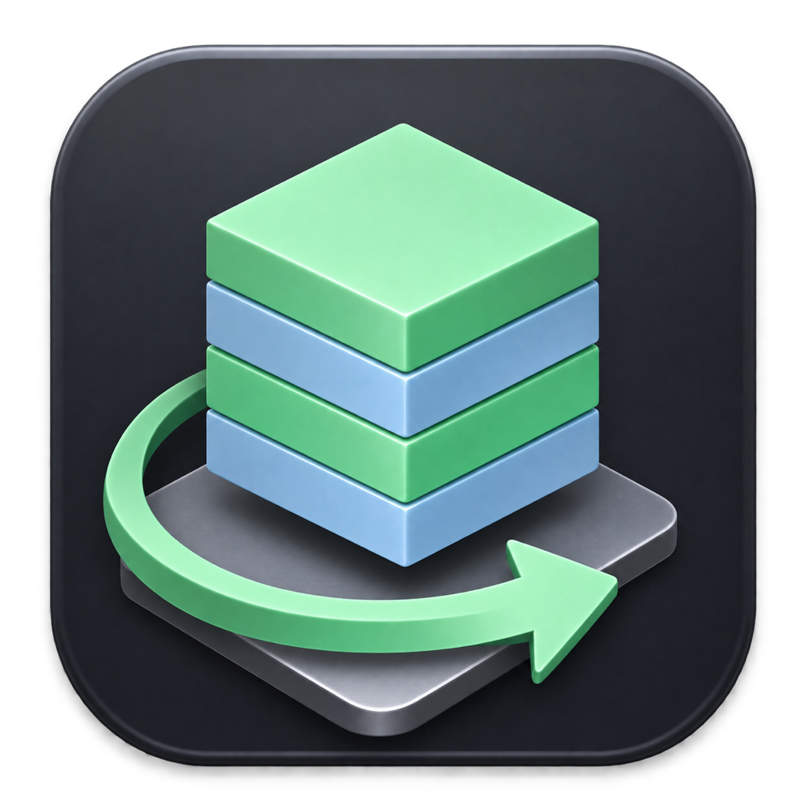
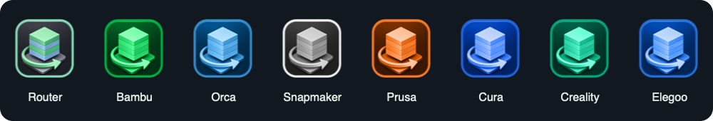
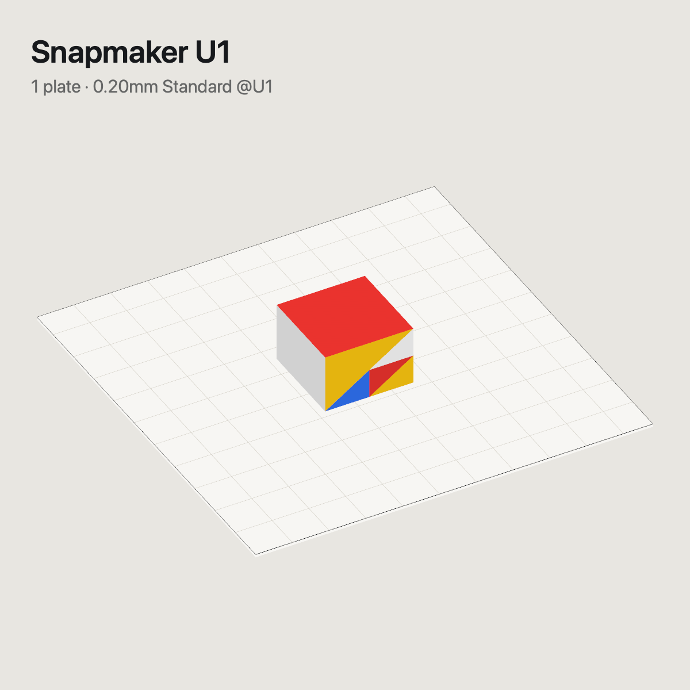
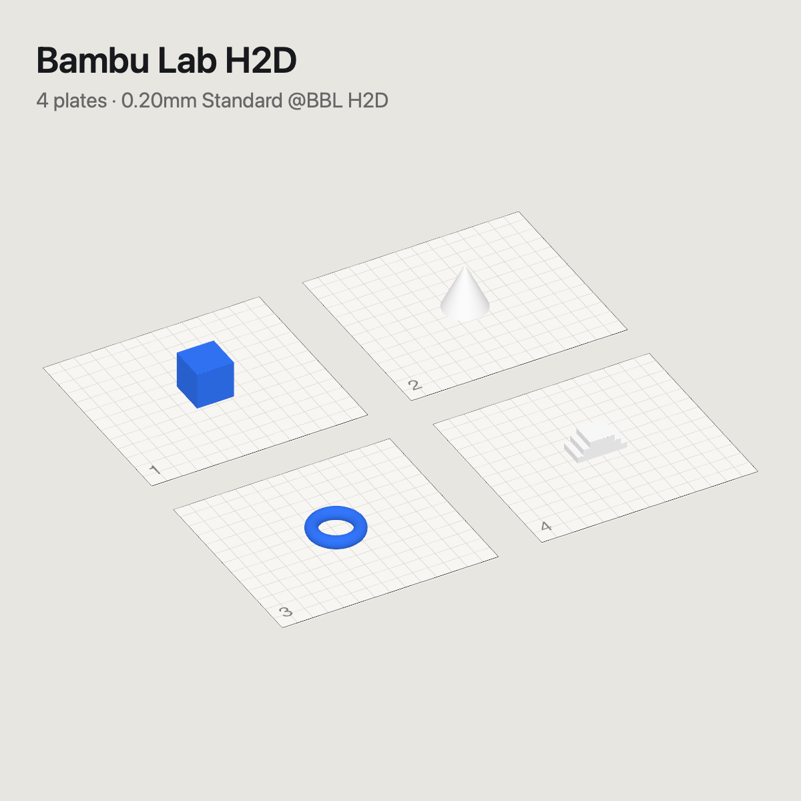
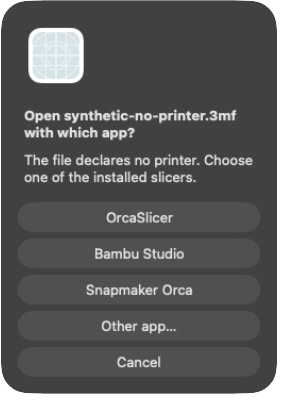

<div align="center">



# 3dSlicerRouter

### O slicer certo. Sua mesa, à primeira vista.

**Automatize a abertura no slicer correto.**<br>
**Veja a mesa antes mesmo de abrir o arquivo.**

Um app nativo do macOS para abrir `.3mf` e `.gcode` no slicer certo, com ícones no Finder,
thumbnails e previews no Quick Look. Tudo funciona localmente, sem conta nem serviço de rede.

<table>
<tr><td align="center">
<h2><a href="https://github.com/MoraesGil/3dSlicerRouter/releases/latest/download/3dSlicerRouter.dmg">↓ Baixar para macOS (.dmg)</a></h2>
<p><strong>Apple silicon + Intel · macOS 14+</strong><br>
Abra o DMG e arraste para Applications.<br>
Sem Xcode, Homebrew ou Terminal.</p>
<p><a href="https://github.com/MoraesGil/3dSlicerRouter/releases">Todas as versões</a> · <a href="docs/INSTALL.pt-BR.md">Guia de instalação</a></p>
</td></tr>
</table>

[](https://github.com/MoraesGil/3dSlicerRouter/actions/workflows/ci.yml)


[](LICENSE)

[Instalar](docs/INSTALL.pt-BR.md) · [Demo do router](#automatize-a-abertura-no-slicer-correto) · [Demo dos previews](#veja-a-mesa-antes-mesmo-de-abrir-o-arquivo) · [English](README.md)

</div>

## Automatize a abertura no slicer correto

Mantenha o 3dSlicerRouter como app padrão de `.3mf` e `.gcode`. Dê dois cliques em um arquivo:
ele lê a impressora salva e abre o **Bambu Studio**, o **OrcaSlicer**, o **Snapmaker Orca** ou o slicer escolhido.
No G-code, ele também identifica o slicer que gerou o arquivo. A escolha manual por arquivo e o
mapeamento explícito da impressora têm prioridade sobre esse gerador. Sem uma regra aplicável,
ele pergunta qual slicer instalado usar.



## Veja a mesa antes mesmo de abrir o arquivo



Os ícones de arquivo no **Finder** usam a logo inteira do Router na cor do slicer de destino.
A borda usa a mesma cor. Arquivos `.3mf` e `.gcode` com o mesmo destino usam a mesma cor.
O macOS também usa esse ícone personalizado na visualização por ícones do Finder. As thumbnails
do modelo continuam disponíveis para clientes do Quick Look. Selecione um arquivo e pressione **Espaço** para abrir o **Quick Look**: gire e amplie um projeto
de uma mesa em 3D ou veja todas as mesas juntas em um projeto com várias mesas. Não é preciso abrir o slicer.

| Uma mesa, cores pintadas | Várias mesas, uma visão geral |
|---|---|
|  |  |

*Previews gerados pelo 3dSlicerRouter com os projetos sintéticos de [samples/](samples/).*

- **Geometria e cores do 3MF:** os previews usam o modelo, as cores dos filamentos e as faces pintadas salvas no projeto.
- **Previews de G-code:** mostram a thumbnail embutida, quando disponível. Sem ela, o app renderiza o
  caminho de extrusão na cor do filamento de cada ferramenta. O Quick Look abre esse caminho em 3D.
- **Render local:** SceneKit e Metal geram os previews no Mac. Não é preciso modelo de IA, API key ou conta.

As solicitações de thumbnail usam a imagem indexada da revisão atual quando ela existe. Sem ela, renderizam a geometria
atual da primeira mesa sob demanda. Se o render falhar ou o projeto comprimido exceder 250 MB, usa a
imagem salva pelo slicer, que pode estar desatualizada. A [indexação em background](#previews-em-background-opcional) é opcional.

## O problema

Bambu Studio, Snapmaker Orca, OrcaSlicer e PrusaSlicer salvam `.3mf`, e o Finder só aceita um app
padrão para essa extensão. Com impressoras de duas marcas, você acaba abrindo um projeto do U1 no
Bambu Studio (ou um da A1 no Orca) e ganha aviso de preset, filamento faltando ou tipo de mesa trocado
sem perceber.

O 3dSlicerRouter vira o app padrão de `.3mf` e `.gcode`. Ele lê o `printer_model` e entrega o arquivo
ao slicer configurado. No G-code, também usa o gerador identificado, depois das escolhas manuais
e dos mapeamentos explícitos. Sem uma regra aplicável, pergunta qual slicer instalado usar.

## Qualquer impressora, qualquer fatiador

| | Impressora no arquivo | Abre no |
|:-:|---|---|
|  | `Bambu Lab A1`, `A1 mini`, `P1S`, `X1C`, `H2D`, … | **Bambu Studio** |
| | `Snapmaker U1`, `J1`, `Artisan`, … | **OrcaSlicer oficial** |
| | `Prusa`, `Original Prusa`, … | **OrcaSlicer oficial** |
| | Qualquer outra (`Elegoo Centauri Carbon`, …) | **OrcaSlicer oficial** |
| | Sem impressora declarada | **Pergunta entre os fatiadores instalados** |

O OrcaSlicer oficial é o padrão para projetos novos de impressoras que não são Bambu. Segure Option
ao abrir para escolher entre os fatiadores instalados ou **Outro app…**, um seletor nativo
para os fatiadores em `/Applications`. Marque *Usar sempre para esta impressora* para definir
uma regra para aquele modelo. Também dá para mapear pelo terminal:

```sh
3dSlicerRouter --map "Original Prusa MK4S" /Applications/PrusaSlicer.app
3dSlicerRouter --mappings
```

Precisa do outro fatiador para um arquivo? **Segure ⌥ (Option) ao abrir** e escolha. O *Abrir com*
do Finder continua funcionando, e o próximo duplo clique lê o arquivo de novo.

## Já está aberto? Nada de segunda janela

O Bambu Studio, o OrcaSlicer e o Snapmaker Orca abrem **outra instância** quando você abre um projeto que já está
aberto, e você acaba editando o mesmo arquivo em duas janelas. O 3dSlicerRouter confere antes. Se o
arquivo é o projeto aberto de um fatiador em execução, ele avisa, diz se há alterações não salvas e
oferece:

- **Ir para o fatiador**: ativa a instância do fatiador em execução.
- **Reiniciar e recarregar**: fecha a instância do fatiador, que pode conter outras janelas. O fatiador
  pode perguntar sobre alterações não salvas antes de reabrir o arquivo do disco.
- **Abrir outra cópia**: o comportamento antigo, se você quiser mesmo.

Ele lê as pastas de recuperação que os fatiadores mantêm em `$TMPDIR` enquanto o projeto está
aberto, então não precisa de permissão extra. `3dSlicerRouter --inspect arq.3mf` mostra o mesmo.

## Previews em background (opcional)

> **Limitação dos builds ad-hoc:** a inicialização em background é experimental. No Mac de teste,
> o macOS rejeitou algumas inicializações do helper por uma restrição de lançamento, mesmo com
> registro habilitado e assinatura válida. Roteamento e previews sob demanda não dependem dele.
> Se o helper não iniciar, use `--render` ou `--index` em foreground. Não desative a segurança do sistema.


Projetos grandes levam segundos para renderizar. Ligue o indexador e eles ficam prontos antes de você
abrir o Finder:

```sh
3dSlicerRouter --background on
```

- Acha todos os `.3mf` e `.gcode` do Mac pelo Spotlight (sem varrer o disco) e mantém um catálogo.
- Acorda a cada 30 minutos com prioridade de background e **só trabalha na tomada, fora do modo de pouca
  energia, com o Mac frio e você ausente há 3 minutos**. Para assim que você volta.
- Os previews ficam em `~/Library/Application Support/3dSlicerRouter/previews`. Salvar invalida a imagem
  gerada, inclusive com o mesmo tamanho dentro do mesmo segundo. A próxima passada elegível renderiza a
  geometria atual da primeira chapa mesmo com imagem embutida antiga e avisa o Finder. Falhas e caches ausentes são repetidos.
- O macOS mostra *Item de segundo plano adicionado*. Dá para desligar em **Ajustes do Sistema › Geral ›
  Itens de Início** ou com `3dSlicerRouter --background off`. Na primeira vez que ele ler arquivos da
  Mesa, Documentos, Downloads ou de um disco externo, o macOS pode pedir sua autorização.

`3dSlicerRouter --index-status` mostra o que ele está fazendo; o log fica em `~/Library/Logs/3dSlicerRouter/indexer.log`.

## Como decide

A tabela abaixo descreve o roteamento de 3MF. No G-code: escolha confirmada por arquivo → mapeamento explícito → gerador declarado → padrão da impressora ou seletor. Um arquivo copiado de outro Mac não autoriza um novo caminho de aplicativo.

| Situação | Resultado |
|---|---|
| Primeira abertura de 3MF | Regra explícita da impressora; sem regra, Bambu Studio para Bambu Lab e OrcaSlicer oficial para as demais |
| Mesmo arquivo, mesma impressora | Onde abriu da última vez, inclusive escolha manual |
| Impressora mudou dentro da marca (A1 → A1 mini) | Mesmo fatiador, sem perguntar |
| Impressora mudou para Bambu Lab (U1 → A1) | Bambu Studio, sem perguntar |
| Impressora mudou para outra marca (A1 → U1) | Pergunta, com o fatiador mapeado em primeiro |
| G-code com gerador identificado | Escolha manual por arquivo e mapeamento explícito têm prioridade; sem eles, usa o gerador |
| Arquivo sem impressora e sem gerador reconhecido | Escolha manual salva; sem escolha manual, pergunta entre os fatiadores instalados |
| Fatiador definido foi desinstalado | Pergunta entre os fatiadores ainda instalados |
| ⌥ segurado ao abrir | Sempre pergunta |
| Arquivo já aberto num fatiador | Ir para ele, reiniciar e recarregar ou abrir outra cópia |

A decisão fica num índice SQLite local e no arquivo, como atributo estendido
(`com.moraesdev.slicer-router`). Os fatiadores substituem o arquivo ao salvar, o que apaga o atributo;
o router então acha a decisão pelo caminho e grava de novo. **O router nunca altera o conteúdo do
arquivo.**

Cada escolha registra bundle ID, caminho e nome do aplicativo. O OrcaSlicer oficial
(`com.orcaslicer.OrcaSlicer`, `/Applications/OrcaSlicer.app`) e o Snapmaker Orca
(`com.snapmaker.snapmaker-orca`, `/Applications/Snapmaker Orca.app`) são escolhas separadas.
As escolhas salvas por arquivo e as regras explícitas por impressora têm prioridade sobre o novo padrão.
O caminho registrado tem prioridade enquanto o aplicativo nele tiver o bundle ID correspondente.
Abrir o arquivo diretamente em outro slicer não atualiza a escolha do router.

> Por que não o campo `Application`? O Snapmaker Orca também grava `BambuStudio-…` nele. A impressora
> vem de `Metadata/project_settings.config` → `printer_model`.

## Instalar

1. **[Baixe 3dSlicerRouter.dmg](https://github.com/MoraesGil/3dSlicerRouter/releases/latest/download/3dSlicerRouter.dmg)**. O mesmo app atende Apple silicon e Intel, no macOS 14 ou mais novo.
2. Abra o DMG e arraste **3dSlicerRouter** para **Applications**. Ejete a imagem de disco.
3. Abra o app em **Aplicativos** e escolha **Usar para .3mf e .gcode**. Mantenha um fatiador instalado.

Você não precisa de Xcode, Homebrew nem Terminal. A Release inclui um ZIP alternativo e hashes SHA-256.

**Autorização na primeira abertura:** o app usa assinatura ad-hoc, sem Developer ID nem notarização.
O macOS pode bloquear a abertura. Se você confia no download, siga as [instruções da Apple para Abrir Mesmo Assim](https://support.apple.com/102445).
Macs gerenciados podem impedir essa autorização. Não desative o Gatekeeper nem remova a quarentena.

<details>
<summary>Compilar a partir do código (desenvolvedores)</summary>

Precisa de macOS 14 ou mais novo e de pelo menos um fatiador.

```sh
brew install xcodegen
git clone https://github.com/MoraesGil/3dSlicerRouter.git && cd 3dSlicerRouter
./scripts/build.sh --install
alias 3dSlicerRouter=/Applications/3dSlicerRouter.app/Contents/MacOS/3dSlicerRouter   # coloque no ~/.zshrc
3dSlicerRouter --set-default
```

O build local usa assinatura ad-hoc. O script não fornece assinatura Developer ID nem notarização.
Dependências, atualização e **desinstalação**: [docs/INSTALL.pt-BR.md](docs/INSTALL.pt-BR.md).

Se o serviço de build do Xcode travar, `./scripts/build.sh --native --test` gera o mesmo app universal e
roda a suíte completa com `swiftc` e `xctest`. O SDK e as ferramentas de linha de comando do Xcode continuam necessários.

</details>

## Teste

Sete projetos 3MF sintéticos pequenos em [`samples/`](samples/) demonstram o roteamento e os previews:

```sh
open samples/bambu-a1-keychain-tray.3mf        # Bambu Studio
open samples/snapmaker-u1-four-colors.3mf      # OrcaSlicer
open samples/no-printer-declared.3mf          # escolher um fatiador instalado
3dSlicerRouter --inspect samples/*.3mf         # mostra cada decisão, sem abrir nada
```

## Linha de comando

`3dSlicerRouter` é o alias da [instalação](#instalar), apontando para
`/Applications/3dSlicerRouter.app/Contents/MacOS/3dSlicerRouter`.

| Comando | O que faz |
|---|---|
| `--inspect arq.3mf\|arq.gcode…` | Impressora, thumbnail, escolha salva e decisão; não abre slicer nem altera o conteúdo |
| `--map "<impressora>" /Applications/App.app` | Manda essa impressora para qualquer fatiador |
| `--mappings` | Lista os padrões por marca e os seus mapeamentos |
| `--list-slicers` | Lista somente os fatiadores instalados e seus caminhos |
| `--render arq.3mf\|arq.gcode out.png [px]` | Preview isométrico em PNG |
| `--background on\|off\|status` | Indexador de previews em background |
| `--index [--limit N]` | Indexa e renderiza agora, ignorando a regra de ociosidade |
| `--index-status` | Estado do indexador, totais do catálogo e caminho do log |
| `--catalog [texto]` | Todos os 3MF e G-code achados, com impressora e estado do preview |
| `--forget arq.3mf\|arq.gcode…` | Apaga a memória do router nesses arquivos |
| `--set-default` | Torna o router o app padrão de `.3mf` e `.gcode` |

## Arquivos sem impressora

Arquivos sem impressora declarada e sem gerador de G-code reconhecido perguntam qual slicer usar.
O seletor verifica instalações em `/Applications`, `~/Applications`, suas subpastas e os registros dos três fatiadores principais
no macOS. Só entram apps com executável presente, incluindo PrusaSlicer e outros fatiadores
reconhecidos quando instalados. Apps removidos e links quebrados ficam fora da lista.

Uma escolha manual salva continua válida para aquele arquivo. Decisões automáticas antigas
que usavam OrcaSlicer por falta de impressora voltam a perguntar. As regras são executadas localmente. O 3dSlicerRouter continua como app padrão de `.3mf` e `.gcode`.

<p align="center">

</p>

*Seletor nativo com sample sintético. A lista corresponde aos fatiadores instalados no Mac de teste.*

## Renderização local e privacidade

As thumbnails usam a geometria e as cores dos filamentos, renderizadas com SceneKit e Metal.
Câmera e iluminação são definidas pelo código. Nenhum modelo de IA participa. Em verificações locais,
o mesmo sample produziu PNGs com hashes iguais. Não há garantia de pixels idênticos entre versões
de macOS ou GPUs diferentes.

O app mantém escolhas, catálogo e previews na pasta Application Support do usuário. O indexador
opcional só lê arquivos visíveis ao Spotlight e permitidos pelo macOS. O aplicativo não tem cliente
de rede nem configuração de credenciais.

## Perguntas frequentes

**Ele mexe nos meus arquivos?** Ele grava metadados de roteamento e do ícone do Finder no arquivo.
O conteúdo do 3MF ou G-code continua idêntico, byte a byte.

**Como escolhe o slicer para G-code?** O Router identifica o gerador nos comentários do arquivo.
Uma escolha manual salva por arquivo ou um mapeamento explícito da impressora tem prioridade.
Segure **⌥ (Option)** ao abrir para escolher outro slicer.

**Todos os ícones mudam logo após instalar?** Não. A logo inteira do Router e sua borda usam a cor
do slicer de destino, igual para `.3mf` e `.gcode`. Os ícones são atualizados ao abrir ou indexar
o arquivo e quando o Finder solicita
uma thumbnail. Arquivos nunca abertos ou indexados podem manter o ícone anterior. A visualização por
ícones do Finder também mostra a logo personalizada; pressione **Espaço** para conferir o modelo no Quick Look. Se o arquivo não permitir escrita ou o sistema de arquivos
não aceitar atributos estendidos, a abertura continua funcionando; o Finder usa o ícone da extensão
ou a thumbnail de fallback.

**O preview atualiza depois que edito o projeto?** Salvar invalida o preview gerado. Na próxima solicitação,
o Finder renderiza a geometria atual da primeira chapa se não houver imagem indexada pronta; o indexador
opcional a prepara na próxima passada ociosa. Apenas o fallback de erro/projeto grande pode manter um
screenshot antigo do fatiador. Fechar sem salvar não muda nada.

**Precisa de permissão especial?** Abrir um arquivo e gerar seu preview não exige Acessibilidade,
Gravação de Tela ou Acesso Total ao Disco. O indexador opcional pode exigir sua aprovação para
atividade em background e acesso a pastas protegidas.

**Manda dados para algum lugar?** Não. Roteamento e previews são executados no seu Mac.
Não exigem serviço de rede, modelo de IA, API key nem conta.

**Ele roda em background?** Só se você ligar o indexador, e mesmo assim só com o Mac ocioso e na tomada.

## Roadmap

- [x] OrcaSlicer oficial como padrão, separado do Snapmaker Orca
- [ ] Padrões prontos para PrusaSlicer, Elegoo Slicer e Creality Print (hoje: *Outro app…* ou `--map`)
- [ ] Janela de configurações para os mapeamentos impressora → fatiador
- [ ] Largura de extrusão (fitas) no preview de G-code
- [ ] Release notarizado

Ideias, impressoras que roteiam errado e PRs são bem-vindos: [CONTRIBUTING.md](CONTRIBUTING.md).

## Aviso

Sem afiliação, endosso ou patrocínio da Bambu Lab ou da Snapmaker. Bambu Studio, Snapmaker Orca e
seus ícones são marcas dos respectivos donos, mostrados só para descrever compatibilidade.

## Licença

[MIT](LICENSE) © Gilberto Moraes ([@MoraesGil](https://github.com/MoraesGil))
